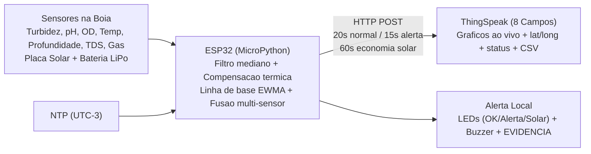

# EcoMangue — Vigilância Ambiental Inteligente do Rio Poxim

> Boias estacionárias IoT de baixo custo em **ESP32 + MicroPython** para monitoramento contínuo de qualidade da água, nível/assoreamento e odor fétido nos manguezais da Farolândia (Aracaju/SE), com detecção de despejo clandestino na borda e geração automática de evidências georreferenciadas com carimbo de tempo.

---

## O Problema e a Solução

- **Dor local:** O descarte irregular de esgoto e resíduos sólidos nas áreas de manguezal que cercam a Farolândia degrada a biodiversidade estuarina do Rio Poxim, gera mau cheiro ($H_2S$, $CH_4$, $NH_3$) e favorece a proliferação de vetores.
- **Solução IoT:** Rede de boias estacionárias autônomas (painel solar + bateria LiPo) capazes de:
  1. Monitorar **7 variáveis ambientais + bateria** em tempo real (`a cada 2 s`).
  2. Aprender automaticamente a linha de base normal do rio (**EWMA + z-score**) e aplicar os limites legais da **Resolução CONAMA 357/2005**.
  3. Cruzar os sensores (**fusão multi-sensor**) para distinguir despejo orgânico/químico de hipóxia/eutrofização ou variações naturais de maré e enxurrada.
  4. Publicar gráficos ao vivo no **ThingSpeak** com **carimbo de tempo oficial (NTP UTC-3)**, **latitude/longitude** e classificação do evento como evidência para órgãos ambientais.

---

## Arquitetura do Sistema



### Estratégia de Baixo Custo e Confiabilidade
- **Geolocalização fixa por boia (`BUOY_ID`, `BUOY_LAT`, `BUOY_LON`):** Como a boia é estacionária/ancorada, elimina-se o módulo GPS, reduzindo custo e consumo energético.
- **Sustentação solar + economia adaptativa:** Com sol ativo, a placa solar recarrega e sustenta a bateria LiPo em `~4.20 V` (`CARREG` → `SUSTENT`). Se passar longos períodos sem sol e a LiPo cair abaixo de `3.35 V`, entra em modo economia (`60 s`) sem atrasar alertas ambientais (`15 s`).
- **Retenção de pico na janela:** Se ocorrer um pico entre dois envios HTTP, a boia armazena e envia o **pior instante** da janela como evidência, garantindo que despejos rápidos não passem despercebidos; se o Wi-Fi cair, retém a evidência para a próxima tentativa.

---

## Hardware, Pinagem e Simulação no Wokwi

O circuito completo está modelado em [`firmware/diagram.json`](firmware/diagram.json) sobre a placa `board-esp32-devkit-c-v4` (todos os pinos analógicos alocados exclusivamente no **ADC1**, pois o ADC2 é desativado quando o Wi-Fi está ativo).

| Parâmetro | Hardware Real (Boia) | Simulação no Wokwi | Pino ESP32 | Faixa / Limite de Alerta |
|---|---|---|---|---|
| **Turbidez** | Sensor óptico SEN0189 | Potenciômetro (`pot1`) | `GPIO 34` (ADC1) | `0–1000 NTU` · Alerta `> 100 NTU` |
| **pH** | Sonda PH-4502C (Nernst c/ temp.) | Potenciômetro (`pot2`) | `GPIO 35` (ADC1) | `0–14` · Faixa CONAMA `6.5–8.5` |
| **Oxigênio Dissolvido (OD)** | Sonda galvânica SEN0237 (c/ saturação $T$/sal) | Potenciômetro (`pot5`) | `GPIO 39 (VN)` (ADC1) | `0–12 mg/L` · Hipóxia CONAMA `< 5.0 mg/L` |
| **TDS / Salinidade** | Sonda TDS Gravity (`2%/°C`) | Potenciômetro (`pot4`) | `GPIO 32` (ADC1) | `0–2000 ppm` · Alerta `> 1400 ppm` |
| **Temperatura da Água** | DS18B20 à prova d'água (1-Wire) | `wokwi-ds18b20` (`temp1`) | `GPIO 4` (+ pull-up 4,7k) | `-40 a 85 °C` (assíncrono) |
| **Profundidade / Nível** | Ultrassônico JSN-SR04T | `wokwi-hc-sr04` (`depth1`) | `TRIG 17` · `ECHO 18` | `2–400 cm` · Assoreamento `< 60 cm` · Cheia `> 320 cm` |
| **Mau Cheiro / Gases** | MQ-135 / MQ-4 ($H_2S$, $CH_4$, $NH_3$) | `wokwi-gas-sensor` (`gas1`) | `AOUT 36 (VP)` · `DOUT 19` | `> 1050 ppm` ou `DOUT == LOW` |
| **Placa Solar** | Painel 5V/2W + CN3065/TP4056 (`CHRG`) | `wokwi-photoresistor-sensor` (`solar1`, slider *lux*) | `GPIO 14` (`DO` ativo em LOW) | Com sol (`> ~350 lux`), carrega e sustenta a LiPo |
| **Bateria LiPo** | LiPo 3,7 V + divisor 100k/100k | Potenciômetro (`pot3`) + simulação de carga | `GPIO 33` (ADC1) | `3.0–4.2 V` · Economia `< 3.35 V` sem sol |
| **Botão Simular Despejo** | Botão de bancada / teste | `wokwi-pushbutton` (`btn1`, tecla **D**) | `GPIO 15` (`PULL_UP`) | Injeta pluma sintética por `30 s` |
| **LEDs OK / Alerta / Solar** | LEDs verde, vermelho e azul | `ledOk` / `ledAlert` / `ledSolar` + R 220 Ω | `GPIO 27` / `26` / `23` | Verde = OK; Vermelho = Alerta; Azul = Carga Solar |
| **Buzzer Local** | Piezoelétrico ativo/passivo | `wokwi-buzzer` (`buzzer1`) | `GPIO 25` (PWM) | Beep curto apenas na transição de entrada/saída |

---

## Inteligência na Borda (MicroPython)

Implementada em [`firmware/main.py`](firmware/main.py) com parâmetros centralizados em [`firmware/config.py`](firmware/config.py):

1. **Filtragem robusta de sinais:**
   - **ADC (filtro mediano aparado):** coleta 15 amostras por leitura, ordena e descarta as 3 menores e as 3 maiores antes de calcular a média, eliminando picos elétricos e ruído de RF do Wi-Fi.
   - **Ultrassônico (mediana de pulsos):** realiza 3 disparos espaçados de `15 ms` com timeout de `30 ms` (`time_pulse_us`) e usa a mediana das leituras válidas.
2. **Compensação térmica e de salinidade:** utiliza a temperatura real medida pelo DS18B20 (e TDS) para corrigir o **TDS** (`2% / °C` ref. `25 °C`), o **pH** (equação de Nernst no modo hardware real) e calcular a **curva de saturação de Oxigênio Dissolvido (`% sat`)**.
3. **Diagnóstico de saúde dos sensores:** monitora desconexão do DS18B20, timeout do ultrassônico e (no modo real) curto/circuito aberto nos pinos analógicos, evitando falsos alertas ambientais por falha física.
4. **Linha de base adaptativa (EWMA + z-score):** após `10` leituras iniciais (~20 s), calcula média e desvio-padrão exponenciais por sensor. Durante alertas, a linha de base **congela** para que um despejo prolongado não passe a ser tratado como normal. Exige `3` leituras normais consecutivas (histerese) para encerrar o alerta e registrar `[NORMALIZADO]`.
5. **Fusão multi-sensor (classificação automática do evento):**
   - `DESPEJO_ORGANICO`: turbidez alta combinada com queda de OD/pH, alta de TDS ou gases.
   - `HIPOXIA_EUTROFIZACAO`: queda de OD (`< 5.0 mg/L` ou `z > 3`) sem pico de turbidez/químicos (risco direto à biodiversidade do mangue).
   - `ENXURRADA_MARE`: subida de nível junto com turbidez, **sem** alteração de pH, gases ou OD (reduz falso positivo em chuva/maré).
   - `ASSOREAMENTO_RESIDUOS`: queda de profundidade abaixo de `60 cm` ou redução brusca sob a boia (entulho/lixo).
   - `ODOR_FETIDO`: pico de gases ou disparo do comparador digital `DOUT`.
   - `DESPEJO_QUIMICO`: violação de pH CONAMA (`6.5–8.5`) ou salto de TDS sem turbidez.
   - `NIVEL_ELEVADO`, `TURBIDEZ_ALTA` e `DESCARGA_TERMICA`.
6. **IQA (0–100) e Tendência de Nível:** estima um Índice de Qualidade da Água ponderado principalmente por **OD (30 pts)**, **Turbidez (25 pts)** e **pH (20 pts)** (`OTIMA`, `BOA`, `REGULAR`, `RUIM`, `CRITICA`) e indica `ENCHENDO`, `VAZANDO` ou `ESTAVEL`.

---

## Dashboard e Provas (ThingSpeak — 8 Campos)

Cada registro enviado por HTTP POST para `api.thingspeak.com/update` inclui automaticamente `lat`, `long`, `created_at` (ISO-8601 com fuso `-03:00`) e, em eventos, recuperações ou bateria baixa (`< 3.35 V`), o campo `status` detalhado:

| Campo | Variável | Observação |
|---|---|---|
| `field1` | Turbidez (`NTU`) | — |
| `field2` | `pH` | Faixa de referência CONAMA 357: `6.5–8.5` |
| `field3` | Temperatura da água (`°C`) | — |
| `field4` | Profundidade / Nível (`cm`) | — |
| `field5` | Oxigênio Dissolvido (`mg/L`) | Limite mínimo CONAMA 357: `5.0 mg/L` |
| `field6` | TDS / Salinidade (`ppm`) | Compensado a `25 °C` |
| `field7` | Gases / Odor (`ppm`) | — |
| `field8` | Score de Anomalia (`z`) | Valores `>= 3.0` indicam evento de alerta ativo |

---

## Como Executar

### 1. Simulação no Wokwi (sem hardware físico)
1. Abra **https://wokwi.com/projects/new/micropython-esp32**.
2. Cole [`firmware/main.py`](firmware/main.py) na aba `main.py`.
3. Cole [`firmware/diagram.json`](firmware/diagram.json) na aba `diagram.json`.
4. No menu **▾ > New file…**, crie `config.py` e cole [`firmware/config.py`](firmware/config.py).
5. *(Opcional, para gráficos ao vivo)* Crie um canal no [ThingSpeak](https://thingspeak.mathworks.com) com os 8 campos ativos, torne a visualização pública em **Sharing** e cole a *Write API Key* em `THINGSPEAK_API_KEY` no `config.py`.
6. Clique em ▶ **Start** e acompanhe o terminal serial.

### 2. Roteiro da Demo no Pitch (2 minutos)
1. **Aprendizado + Carga Solar (0–20 s):** Mostre o LED verde piscando (aprendendo o estado basal do Rio Poxim: `IQA ~96 - OTIMA`, `OD ~7.5 mg/L`) e o **LED azul `SOLAR` aceso**, sustentando a LiPo até `4.20 V (100%, SUSTENT)`.
2. **Ciclo Dia/Noite:** Clique em `Placa Solar (Sol)` e arraste o slider para `< 100 lux` → LED azul apaga, boia entra em `BATERIA` (e em `ECONOMIA_SOLAR` se baixar de `3.35 V`); volte ao sol para retomar a recarga.
3. **Despejo Clandestino (tecla `D`):** Clique no diagrama e aperte **D**. Turbidez, TDS, gases, temperatura e nível sobem enquanto o pH (`< 6.5`) e o **OD (`< 5.0 mg/L`)** despencam por consumo orgânico. A boia soa um beep curto, acende o alerta vermelho, classifica como `DESPEJO_ORGANICO`, imprime o bloco **EVIDÊNCIA** (com `% saturação` de OD, link direto do Google Maps e timestamp) e publica o pico no ThingSpeak.
4. **Hipóxia / Eutrofização:** Gire o potenciômetro `Oxig. Diss. (OD)` para `< 5.0 mg/L` → alerta `HIPOXIA_EUTROFIZACAO`.
5. **Resíduos Sólidos / Assoreamento:** Clique no `HC-SR04` e deslize a distância para `< 60 cm` → alerta `ASSOREAMENTO_RESIDUOS`.
6. **Mau Cheiro:** Clique no sensor de gás e eleve o slider → alerta `ODOR_FETIDO`.

### 3. Passando para o Hardware Físico
- Grave `config.py` e `main.py` no ESP32 (via Thonny ou `mpremote`).
- Em `config.py`, altere `WOKWI_SIMULATION = False` e preencha `WIFI_SSID` / `WIFI_PASSWORD`.
- Ligue o painel solar (5–6 V / 2 W) a um controlador de carga **CN3065** ou **TP4056** conectado à bateria LiPo 3,7 V, ligando o pino `CHRG` (com pull-up/divisor se > 3,3 V) ao `GPIO 14`.
- Calibre `PH_NEUTRAL_VOLTAGE` / `PH_SLOPE` (soluções pH 7 e 4) e `DO_CAL_VOLTAGE` (sonda SEN0237 saturada ao ar/água aerada).
- Se instalar o ultrassônico à prova d'água **JSN-SR04T** acima da lâmina d'água (estaca/ponte), defina `DEPTH_MOUNT_HEIGHT_CM` (ex.: `350.0`).
- **Atenção elétrica:** use divisores de tensão (ex.: `10 kΩ / 20 kΩ`, fator `1.5` configurado em `config.py`) nos módulos alimentados em 5 V (`SEN0189`, `PH-4502C`, módulo MQ e pino `ECHO` do JSN-SR04T) para limitar a entrada nos pinos do ESP32 a no máximo `3,3 V`.

---

## Estrutura do Repositório

```text
ecomangue/
├── README.md                 # Visão geral do projeto (este arquivo)
└── firmware/
    ├── main.py               # Firmware MicroPython completo (leitura, fusão, NTP, HTTP)
    ├── config.py             # Parâmetros de rede, ThingSpeak, geolocalização e limites
    ├── diagram.json          # Circuito pronto para simulação no Wokwi
    └── README.md             # Guia rápido focado no firmware e controles Wokwi
```
